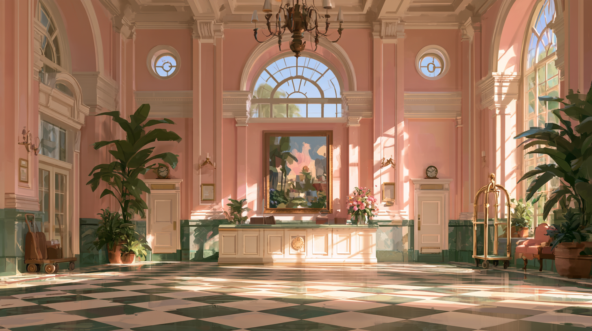
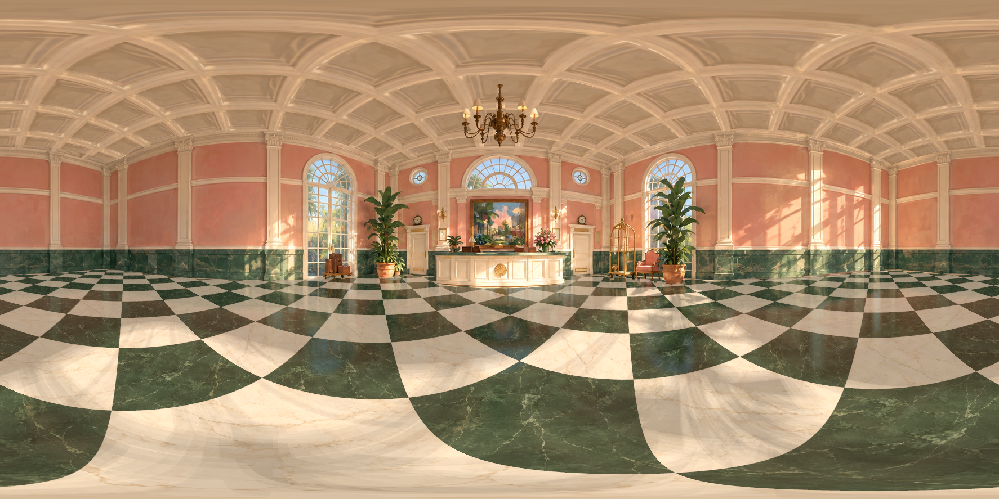
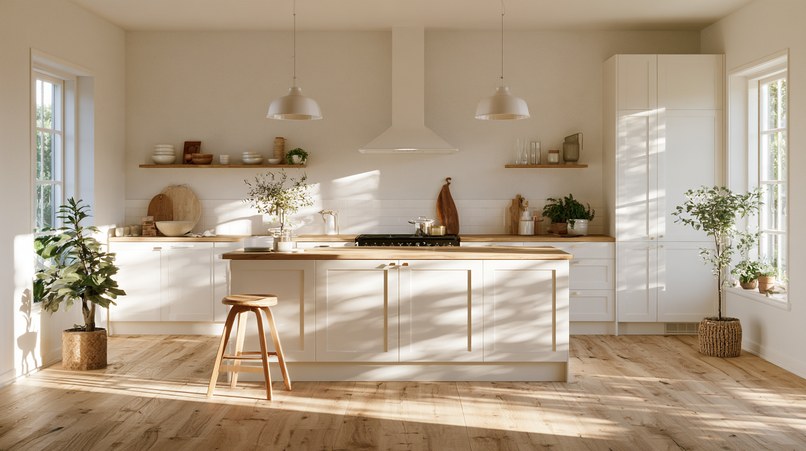
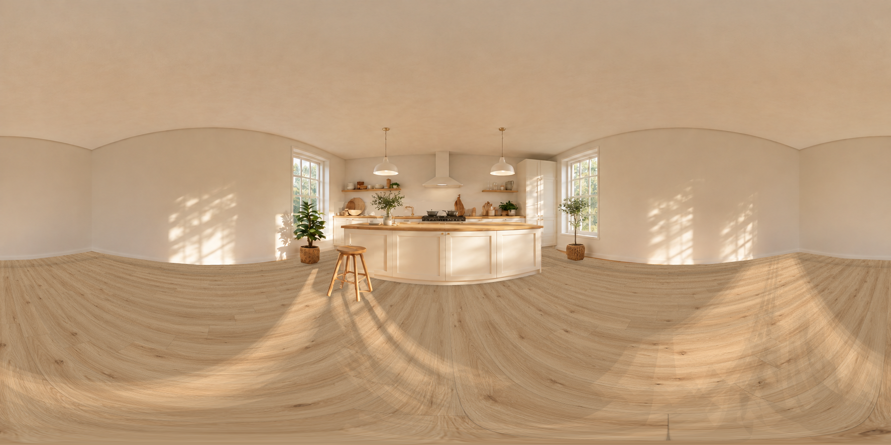
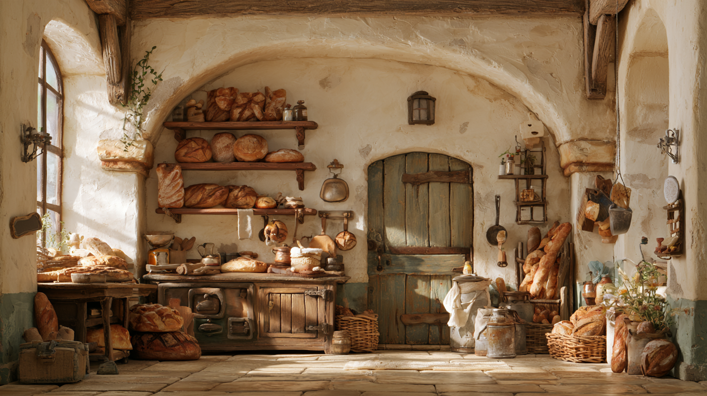
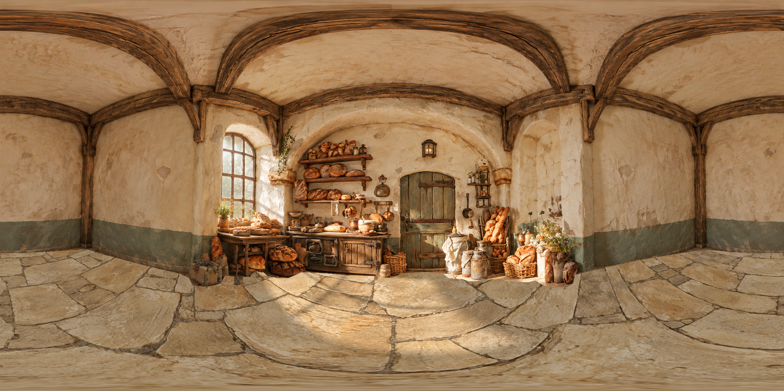

```text
                          . :  Z E N I T H  : .
                    .-'          |          '-.
                 .-'             |             '-.
    <-----------+----------------+----------------+----------->
                |    ____   ___    _   __  ____    |
                |   / __ \ /   |  / | / / / __ \   |
                |  / /_/ // /| | /  |/ / / / / /   |
                | / ____// ___ |/ /|  / / /_/ /    |
                |/_/    /_/  |_/_/ |_/  \____/     |
    <-----------+----------------+----------------+----------->
                 '-.             |             .-'
                    '-.          |          .-'
                          ' :  N A D I R  : '

                G E O M E T R Y - G U I D E D
                  360 x 180  /  ALL AROUND
```

# Geometry-Guided Panorama

**Turn a scene image into a 360° panorama while keeping the look and structure of the reference.**

Use it for interiors, architecture, streets, forests, and other environments. You can also start from a text description or inspect an existing panorama for distortion. The output is a **2:1 panoramic PNG** for viewers that support equirectangular images.

This is a skill for an AI agent with access to image generation and local script execution.

## 1. Install it in your project

Send this to your agent:

```text
Install https://github.com/Jingquank/geometry-guided-panorama
into .agents/skills/geometry-guided-panorama in the current project.
Keep the complete skill package, including its scripts and supporting files.
If it is already installed, review the differences before updating it.
```

The scripts need Python 3, NumPy, Pillow, and a C++17 compiler for geometry rendering. Image generation comes from your agent's environment; this repository does not include an image model. Ask your agent to check these requirements before starting.

## 2. Add an image and say what to preserve

Select `geometry-guided-panorama` in your project conversation, attach a reference image, and describe what you want. For example:

```text
Use $geometry-guided-panorama to expand this reference into a 360° panorama.
Preserve the original structures, materials, and lighting.
Complete unseen areas conservatively, following the reference.
After inspecting the panorama, deliver one 2:1 PNG.
```

You do not need to specify projection math. Just explain **what must stay and what may change**. Anything you have not asked to change should follow the reference.

## 3. Real examples: Before / After

These are actual reference images and generated panoramas from this project. Click an image to open the full PNG. They were produced during earlier iterations and have not all been validated against the latest review process or a downstream 3D reconstruction workflow.

### Example 01 — Pink Hotel Lobby

A panorama expansion of the pink walls, arched windows, and existing checkerboard floor.

| Before · Reference | After · 360° Panorama |
| --- | --- |
| [](assets/examples/pink-lobby-before.png) | [](assets/examples/pink-lobby-after.png) |

[Open the full panorama PNG](assets/examples/pink-lobby-after.png)

### Example 02 — Sunlit Kitchen

White cabinetry, an oak island, and a wooden plank floor. This version still showed curved island edges and light bands after PINOC reconstruction; it remains a case for further improvement.

| Before · Reference | After · 360° Panorama |
| --- | --- |
| [](assets/examples/oak-kitchen-before.png) | [](assets/examples/oak-kitchen-after.png) |

[Open the full panorama PNG](assets/examples/oak-kitchen-after.png)

### Example 03 — Rustic Bakery

Timber beams, an arched doorway, and bread displays. This version omits the small mat in the reference and changes the size of some floor stones.

| Before · Reference | After · 360° Panorama |
| --- | --- |
| [](assets/examples/bakery-before.png) | [](assets/examples/bakery-after.png) |

[Open the full panorama PNG](assets/examples/bakery-after.png)

The images above are flat panorama layouts. Open them in a viewer that supports 2:1 equirectangular images to look around.

## What gets checked?

The agent identifies structures and materials in the reference, generates the panorama, then inspects **18 baseline views plus additional views of important features**.

Checks cover object shapes, occlusion and contact, lighting, textures, seams, and coverage above and below the camera. The reference determines the constraints: wooden boards need consistent placement, forests need natural forms, and a floor without a grid should stay that way.

To report a problem, provide **the exact panorama PNG, a screenshot, and the direction where the issue appears**. If you used 3D reconstruction, include the tool and workflow so the input image and reconstruction stages can be investigated separately.

**A panorama passing inspection does not mean its 3D reconstruction will pass.** Unseen areas are plausible completions. This skill does not guarantee recovery of the real scene geometry or correct results in every reconstruction tool.

---

For the full workflow, see [the skill instructions](SKILL.md) and [general-scene inspection](references/general-scene-qa.md).
